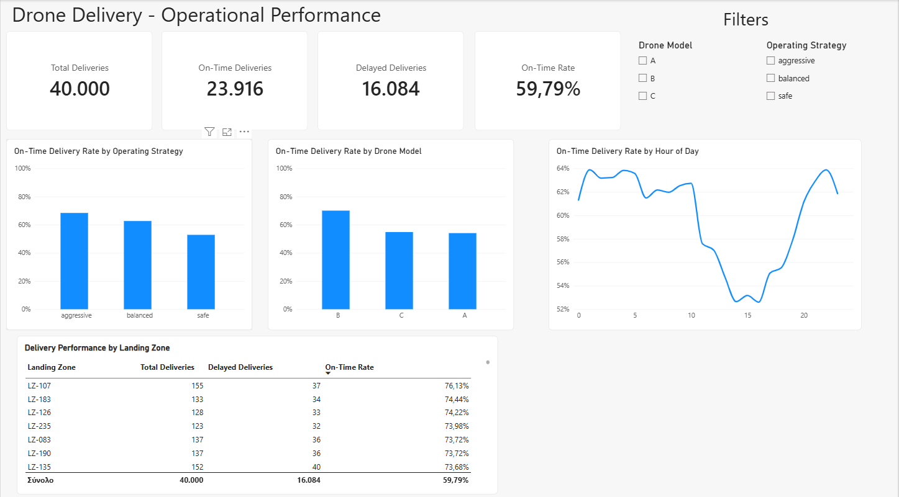

# Drone Delivery Analytics — Machine Learning & Power BI

## Project Overview

An end-to-end data analytics project combining Python-based exploration,
machine learning and interactive Power BI reporting on 40,000 labelled
drone deliveries.

The machine learning pipeline predicts whether deliveries will arrive
on time. The Power BI report explores observed delivery performance
across drone models, operating strategies, hours of the day and landing zones.

## Power BI Dashboard

[View the Power BI report file](Drone_Delivery_Dashboard.pbix)

### Report features

- KPI cards for total, on-time and delayed deliveries, and on-time delivery rate.
- Performance comparisons by drone model and operating strategy.
- On-time delivery rate by hour of the day.
- Landing-zone performance table with delivery counts and on-time rates.
- Interactive filters for drone model and operating strategy.

### Dataset overview

| Metric | Value |
|---|---:|
| Total deliveries | 40,000 |
| On-time deliveries | 23,916 |
| Delayed deliveries | 16,084 |
| On-time delivery rate | 59.79% |

On-time delivery rate is calculated as the number of deliveries with
`on_time = 1` divided by the total number of deliveries in the current
filter context.

### Opening and refreshing the report

Download `Drone_Delivery_Dashboard.pbix` and open it in Power BI Desktop.

The report uses `data/processed/train_eda_engineered.csv`.
To refresh it on another computer, update the CSV source path
to the local copy of this file.

### Scope and limitations

The dashboard presents observed outcomes in the labelled dataset,
rather than model predictions or live operational data.

The dataset includes time-of-day information but no calendar dates
or delay durations. Monthly trends and delay lengths therefore
cannot be reported.

## Machine Learning Workflow

1. Exploratory data analysis.
2. Feature engineering.
3. Preprocessing and model training.
4. Hyperparameter optimisation using RandomizedSearchCV.
5. Model comparison and bootstrap validation.
6. Model interpretation.
7. Final pipeline export and inference.

## Models

- Logistic Regression — selected model.
- Random Forest.
- HistGradient Boosting.

## Evaluation Metrics

ROC-AUC, PR-AUC, accuracy, precision, recall, specificity,
F1-score and Matthews correlation coefficient (MCC).

## Main Project Files

| File or folder | Purpose |
|---|---|
| `Drone_Delivery_Dashboard.pbix` | Interactive Power BI report |
| `dashboard_overview.png` | Dashboard preview |
| `Drone_Delivery_Presentation.pptx` | Project presentation |
| `notebooks/01_EDA_Drone_Delivery_updated.ipynb` | Exploratory data analysis |
| `notebooks/02_Model_Training.ipynb` | Model training and evaluation |
| `notebooks/03_Final_Model_Manager_Report_Production.ipynb` | Final model, interpretation and reporting |
| `data/processed/train_eda_engineered.csv` | Engineered dataset used by the dashboard |
| `src/` | Reusable Python modules |
| `outputs/` | Saved metrics, models and result tables |
| `figures/` | Analysis and model evaluation figures |

## Technologies

- **Python:** pandas, NumPy, scikit-learn, matplotlib, SciPy, joblib.
- **Reporting:** Microsoft Power BI, Power Query, DAX.

## Project Purpose

Developed for educational and portfolio purposes.
